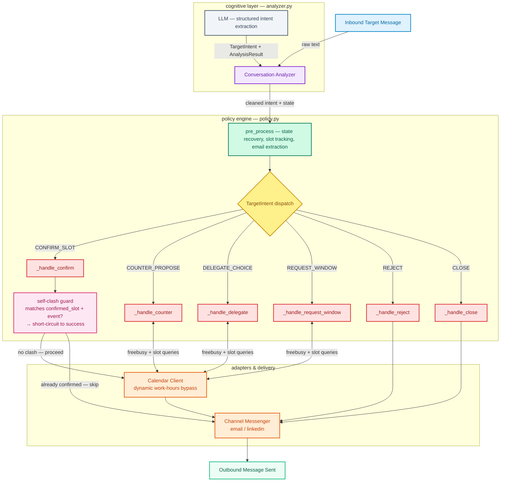

# Meeting Scheduling Agent

Local agentic scheduling system. It loads a demo dataset of actors and conversations, lets a tester play the target, checks availability, sends channel-specific replies, and books a Google Calendar event with a Meet link after confirmation.

## DEMO

<!-- Add a demo recording here. Run `uv run scheduler demo --calendar mock` and capture the terminal. -->

## Architecture Concept



### Architectural & Security Boundaries

```text
Local execution space (Local Execution Context):
- Never shares calendar tokens or active credentials with the LLM APIs.
- Retains complete state control in SchedulingState memory.
- Enforces strict work-hours and weekend constraints locally in code.

External API interactions (External API Services):
- OpenRouter/Gemini API: Receives ONLY conversational context; never decides on booking.
- Google Calendar API: Receives ONLY finalized, locally validated event requests.
```

## Quick Start & Setup

### 1. Install Dependencies
Make sure you have [uv](https://astral.sh) installed, then sync the dependencies:
```bash
# Sync all dependencies including dev tools
uv sync --extra dev
```

### 2. Configure Environment & Credentials
You can configure your environment variables in **two ways**:
1. **Using a `.env` file (Recommended)**: Create a `.env` file in the root of the project. The application automatically loads variables from `.env` using `python-dotenv` on startup.
2. **Using shell exports**: Run `export KEY=VALUE` directly in your terminal.

#### API Keys Configuration (Add to `.env` or export):
```bash
# If using Google Gemini (Recommended):
GEMINI_API_KEY=your_gemini_api_key_here
GEMINI_MODEL=gemini-2.5-flash

# If using OpenRouter:
OPENROUTER_API_KEY=your_openrouter_api_key_here
OPENROUTER_MODEL=openai/gpt-5-mini
```

#### Google Calendar Credentials:
1. Create a Google Cloud OAuth client for a Desktop app and download the client JSON.
2. Save it as `credentials.json` in the root directory of this repo, or specify the path in your `.env` or shell:
   ```bash
   GOOGLE_CALENDAR_CREDENTIALS=/path/to/credentials.json
   ```

### 3. Demo Dataset

The repo ships a synthetic dataset (`fixtures/actors.json`, `fixtures/conversations.json`) with fictional actors so everything runs out of the box. To run the demo against your own dataset:

```bash
export SCHEDULER_ACTORS=/path/to/actors.json
export SCHEDULER_CONVERSATIONS=/path/to/conversations.json
# or pass --actors/--conversations to each command
```

---

## Running the Interactive Demo

### Run with Google Calendar (Real Booking)
This mode reads free/busy slots from your primary calendar, checks availability dynamically, and blocks real events with Google Meet links:
```bash
uv run scheduler demo --calendar google
```
*Note: On the first run, a Google OAuth consent screen will open in your browser. Log in to authorize the app. The access token is saved locally as `token.json` for subsequent runs.*

### Run with Mock Calendar (Deterministic Simulation)
If you do not want to connect to a live Google calendar, use the mock calendar client:
```bash
uv run scheduler demo --calendar mock
```

---

## LLM Provider Selection
By default, the agent automatically detects whether `GEMINI_API_KEY` or `OPENROUTER_API_KEY` is set. If both are available, you can explicitly force a provider:
```bash
LLM_PROVIDER=gemini       # Force Google Gemini
# or
LLM_PROVIDER=openrouter   # Force OpenRouter
```

Analyzer debugging:

```bash
uv run scheduler inspect-analyzer --scenario 1 --prompt-only
uv run scheduler inspect-analyzer --scenario 1
```

## Google Calendar Setup

1. Create a Google Cloud OAuth client for a Desktop app.
2. Download the client JSON.
3. Save it as `credentials.json` in the repo root, or set:

```bash
export GOOGLE_CALENDAR_CREDENTIALS=/path/to/oauth-client.json
export GOOGLE_CALENDAR_TOKEN=token.json
```

4. Run:

```bash
uv run scheduler demo --calendar google
```

On first run, a browser OAuth flow opens. The app stores `token.json`, reads free/busy from the primary calendar, creates events, and requests Google Meet conferencing.

## Harness Commands

- `/state`: full scheduling state JSON
- `/tools`: tool calls
- `/slots`: proposed/rejected/confirmed slots
- `/thread`: current thread
- `/quit`: exit

After booking, the harness shows the event panel and enters an inspection-only mode.

## Tests

```bash
uv run pytest
```

44 tests covering date parsing, analyzer extraction/repair, policy decisions, calendar filtering, eval checks, and agent integration.

## Evaluation Smoke

```bash
bash scripts/run_evaluation.sh
```

Run the local evaluation scenarios with verbose outputs:
```bash
uv run scheduler eval --verbose
```

### Run Trace Logging
Every evaluation run or interactive demo session automatically saves full trace logs (including the final state, proposed/confirmed slots, exact message text, tool calls, and edge case flags) as JSON to the `eval_runs/` directory for trace analysis and debugging.
- Eval trace filename pattern: `eval_runs/eval_{mode}_{timestamp}.json`
- Demo trace filename pattern: `eval_runs/demo_{scenario}_{timestamp}.json`

## What Is Real Versus Mocked

- **Real**: Google Calendar free/busy, event creation, and Google Meet link when using `--calendar google`.
- **Mocked**: LinkedIn and email message delivery. The agent records and renders channel messages locally for inspection.
- **Mocked in tests**: calendar availability and Meet link, to keep tests deterministic.

## Notes

- All demo data in `fixtures/` is synthetic and fictional.
- The demo harness anchors scenario dates to `2026-05-23` (override with `--current-date`).
- Message adapters and the default demo calendar are intentionally local mocks so the project runs offline; see the architecture notes in `docs/`.
